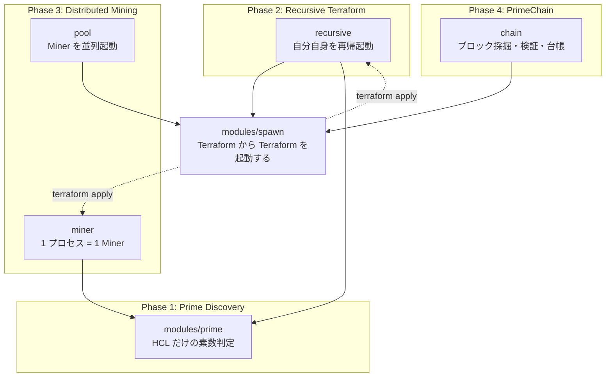
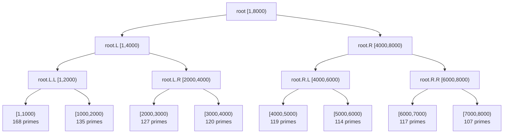
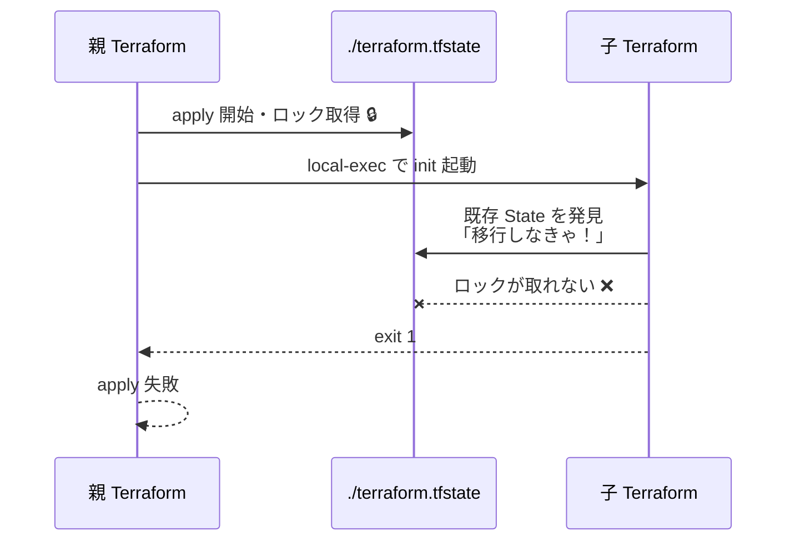
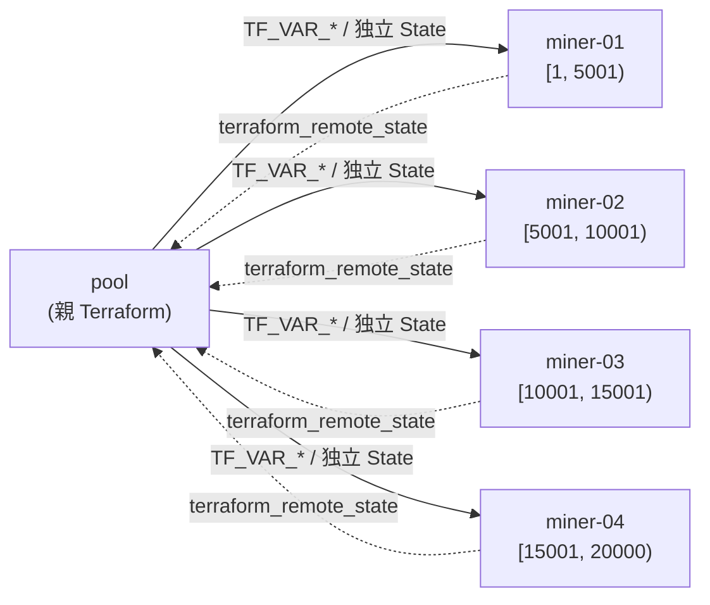
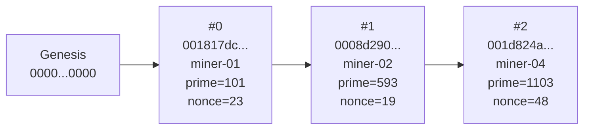
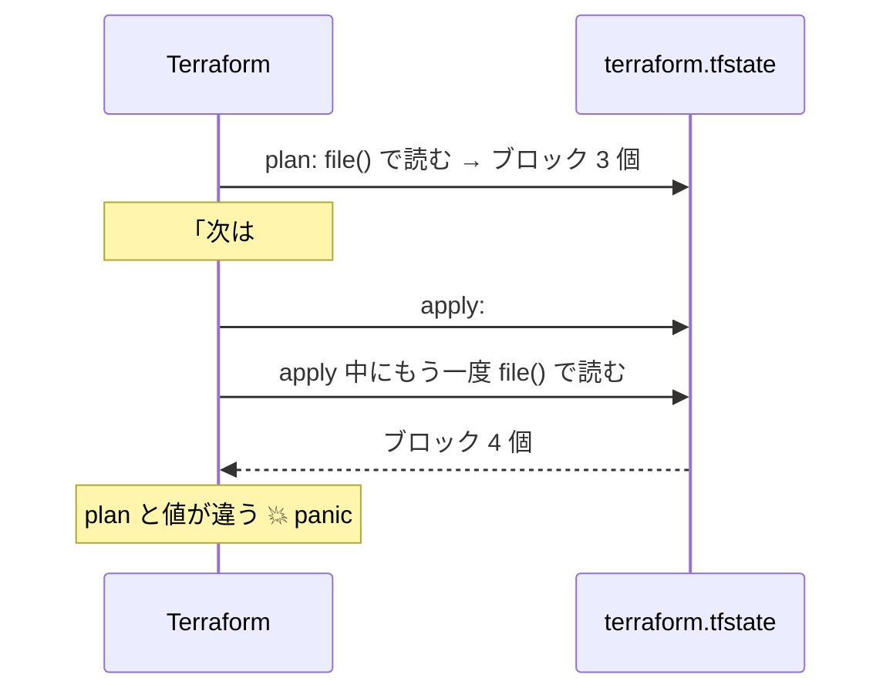

# Terraformで素数をマイニングしたら、ブロックチェーンが生まれた

> Infrastructure as Code。つまり Code。なら何でもできますよね？

## この記事の結論

Terraform（HCL）だけで素数を探索し、それを Proof of Work に組み込んだブロックチェーンを作りました。実際に動いて、改ざん検知も効きます。

- 計算ロジック（素数判定・ハッシュ計算・マイニング条件・ブロック検証）は **すべて HCL**
- シェルがやるのは「Terraform を起動する」「HCL が作った文字列をファイルに置く」だけ
- 外部 Provider は使わない（`terraform_data` / `terraform_remote_state` のみ）

成果として得られた数字がこれです。

| 項目                                                      |             結果 |
| --------------------------------------------------------- | ---------------: |
| `[1, 100000)` の素数探索（1 プロセス）                    |       2 分 02 秒 |
| 同上（8 Miner 並列）                                      |            38 秒 |
| 再帰起動した Terraform プロセス数（`END=8000 LEAF=1000`） |            15 個 |
| ブロック 1 個あたりの sha256 計算回数                     |      約 5,000 回 |
| HCL の実効スループット（概算）                            | 約 17 万 演算/秒 |

ソースコードはこちらです: https://github.com/tanahiro2010/terraform-primechain

そして、この記事で一番伝えたい技術的な学びを先に書いておきます。

**Terraform でハマるところは、ほぼ全部 State 絡みです。** 今回ぶつかった 3 つの壁（`terraform init` が State を移行しようとしてロック競合する／apply 中に State が書き換わって panic する／子プロセスの戻り値をどこに置くか）は、全部「Terraform が State を中心に動いている」ことの裏返しでした。インフラを書いているだけだと気づきにくいこの性質が、計算基盤として酷使すると真正面から出てきます。

> この記事は LT「Terraformで素数をマイニングしたら、ブロックチェーンが生まれた」の内容に、発表では話しきれなかった計測と考察を足したものです。実用性はありません。ただし Phase 2 のプロセス間通信パターンと Phase 4 の `precondition` による不変条件検証は、普通に実務で使えます。

---

## 1. 発端：Infrastructure as **Code**

Terraform は HashiCorp が作っているインフラ管理ツールです。「このサーバーを 3 台」と設定ファイルに書いて `terraform apply` すると、実際のクラウドがその状態になる。いわゆる Infrastructure as Code（IaC）の代表格です。

ある日、この言葉を眺めていて気づきました。

Infrastructure as **Code**。

つまり、**Code** です。

Code なら、素数のマイニングもできますよね？

できました。

### 自分に課したルール

ネタプロジェクトではありますが、ルールが緩いと「結局シェルで計算してるじゃん」になって何も面白くなくなります。なので最初に制約を決めました。

1. 計算ロジックはすべて HCL で書く。素数判定、ハッシュ生成、マイニング条件の判定、ブロック検証すべて。
2. Python / JavaScript / Go / Rust などで計算したら負け。
3. 外部 Provider への計算の委譲も禁止。使っていいのは Terraform 組み込みの `terraform_data` と `terraform_remote_state` だけ。
4. シェルと Makefile がやっていいのは「ディレクトリを作る」「`terraform` コマンドを起動する」「HCL が生成した文字列をファイルに書く」の 3 つだけ。
5. 再帰処理は Terraform から Terraform CLI を起動することで実現する。

**Terraform 以外に計算させたら負け。**

この 4 番目が地味に効いていて、「じゃあ台帳の JSON はどうやって書くの？」「`jq` は使っていいの？」という線引きの問題が後から効いてきます。これは最後の章で整理します。

### 全体構成

最終的にこうなりました。



`modules/spawn` が全体の要です。「Terraform から Terraform を起動して、結果を受け取る」という 1 つの仕組みを作れば、再帰も並列も分散採掘も全部これで書けます。

---

## 2. Phase 1: HCL だけで素数を探す

**結論から言うと、素数判定は HCL の 1 行で書けます。そして `terraform apply` は「リソースを 0 個作って素数だけ返す」という動きをします。**

### HCL にループはないが、`for` 式はある

HCL には `for` 文も `while` 文もありません。手続き的な繰り返しが存在しない言語です。

ただし **`for` 式** はあります。Python のリスト内包表記に相当するもので、HCL で繰り返しを書く唯一の手段です。

素数判定は素直に試し割り法を使います。`n` が素数であるとは、`2` から `floor(√n)` までのどの整数でも割り切れない、ということです。これをそのまま `for` 式に落とします。

```hcl
locals {
  candidates = range(var.start, var.end)

  # n が素数 ⇔ 2..floor(√n) のどれでも割り切れない
  primes = [
    for n in local.candidates : n
    if alltrue([for d in range(2, floor(pow(n, 0.5)) + 1) : n % d != 0])
  ]
}
```

`alltrue()` は真偽値のリストが全部 `true` かを判定する組み込み関数です。「どの除数でも余りが 0 にならない」がこれ 1 つで書けます。

`pow(n, 0.5)` で平方根を取っていますが、HCL に `sqrt()` はありません。`floor()` で整数に落として `+1` するのは `range()` の終端が排他的だからです。

### `terraform apply` の結果

```console
$ terraform apply -var start=1 -var end=100

Apply complete! Resources: 0 added, 0 changed, 0 destroyed.

Outputs:

primes = [2, 3, 5, 7, 11, 13, 17, 19, 23, 29, 31, 37, 41,
          43, 47, 53, 59, 61, 67, 71, 73, 79, 83, 89, 97]
summary = "[1, 100) の 98 個の整数を判定し、25 個の素数を発見しました（最大: 97）"
```

注目してほしいのは **`Resources: 0 added`** です。

インフラは何ひとつ作っていません。`terraform apply` が、ただ素数を計算しているだけです。Terraform を「リソースを作るツール」ではなく「式評価エンジン」として使うと、こうなります。

### ハマりポイント①：`range()` は 1024 要素までしか作れない

最初の壁がこれでした。

```console
$ echo 'length(range(1025))' | terraform console

Error: Error in function call
```

Terraform の `range()` 関数には 1024 要素という上限があります。これは HCL が設定ファイルの言語だからで、「うっかり巨大なリストを式評価で作ってメモリを食いつぶす設定」を書けないようにするためのガードです。普通にインフラを書いていて 1024 要素を超えることはまずないので、この制限に気づく人は少ないと思います。計算基盤として使うと真っ先にぶつかります。

対策は、探索範囲を 1024 ずつのチャンクに分割してから `flatten()` で平らにすることです。

```hcl
locals {
  # range() は 1 回で最大 1024 要素まで
  # → 探索範囲を 1024 ずつのチャンクに分割してから flatten する
  chunk_size   = 1024
  lower        = max(var.start, 2)
  chunk_starts = var.end > local.lower ? range(local.lower, var.end, local.chunk_size) : []

  candidates = flatten([
    for s in local.chunk_starts : range(s, min(s + local.chunk_size, var.end))
  ])
}
```

ここで **扱える `n` の上限が決まります**。候補側はチャンク分割で無限に伸ばせますが、除数側の `range(2, floor(√n) + 1)` もまた 1024 要素以内に収まる必要があるからです。

`√n + 1 ≤ 1024 + 2` から、`n ≤ 1024² = 1,048,576`。

なので variable にバリデーションを入れました。

```hcl
variable "end" {
  type = number

  validation {
    # 試し割りの除数 range(2, √n + 1) も 1024 要素以内に収める必要がある
    condition     = var.end <= 1048576
    error_message = "end は 1048576 (= 1024^2) 以下にしてください。range() は 1024 要素までしか作れません。"
  }
}
```

これを超えたい場合は、除数側もチャンク分割すれば原理的には伸ばせます。ただし後述する HCL の評価モデルの都合で、現実的には先にメモリの壁が来ます。

### 計測：10 万までで 2 分

```console
$ make prime START=1 END=100000

summary = "[1, 100000) の 99998 個の整数を判定し、9592 個の素数を発見しました（最大: 99991）"

real  2:02.14
```

2 分。遅い。

### 考察：なぜここまで遅いのか

LT では「遅い」で笑いを取って次に行きましたが、この遅さには HCL の評価モデルに起因する明確な理由があります。ここは記事なので掘り下げます。

**HCL の `for` 式には短絡評価がありません。**

普通の言語で試し割り法を書くと、こうなります。

```python
def is_prime(n):
    for d in range(2, int(n ** 0.5) + 1):
        if n % d == 0:
            return False   # ← ここで即座に抜ける
    return True
```

偶数なら `d = 2` の 1 回で終わります。探索範囲の約半分はこれで即座に脱落するので、実際の計算量は見た目よりずっと小さくなります。

ところが HCL の `alltrue([for d in ... : n % d != 0])` は、**まず `for` 式が除数リストを全部評価して真偽値のリストを作り、それから `alltrue()` がそのリストを見ます**。`n = 100000` が偶数だろうと、`floor(√100000) = 316` 個の剰余演算がすべて実行されてから「あ、`false` が入ってますね」と判定されます。

つまり HCL では、**合成数も素数も同じコストがかかります**。

これを踏まえて総演算回数を見積もると、`[1, 100000)` の全候補について `√n` 回ずつ剰余を取るので、

$$
\sum_{n=2}^{100000} \sqrt{n} \approx \int_0^{100000} \sqrt{n}\, dn = \frac{2}{3} \cdot 100000^{1.5} \approx 2.1 \times 10^7
$$

約 2,100 万回の剰余演算です。これが 122 秒なので、**HCL の実効スループットは約 17 万演算/秒、1 演算あたり約 5.8 マイクロ秒** という計算になります。

（この数字は「剰余演算 1 回」を単位とした概算で、リスト構築やメモリ確保のコストも全部ここに含まれています。厳密なベンチマークではありません。）

1 演算に 5.8 マイクロ秒というのは、インタプリタ言語としても相当遅い部類です。HCL は式ごとに `cty` という動的型システムの値オブジェクトを生成するので、ネイティブの整数演算とは比べ物になりません。そもそも設定ファイルを評価するための仕組みなので当然ではあります。

もう 1 つ重要なのが、**HCL には遅延評価がない** ことです。`candidates` も `attempts`（後述）も、すべて一度メモリ上にリストとして完全展開されます。ストリーム処理のように「必要な分だけ計算する」ことができないので、探索範囲を広げると計算時間とメモリ使用量が同時に効いてきます。

この 2 つ──**短絡評価がない**、**遅延評価がない**──が、以降のすべての Phase の設計を縛ることになります。

---

## 3. Phase 2: Terraform が Terraform を再帰起動する

**結論：HCL に再帰関数はありませんが、Terraform から `terraform apply` を呼べば再帰できます。引数は `TF_VAR_*` 環境変数、戻り値は `terraform_remote_state`。要するにプロセス間通信です。**

### 発想

2 分かかるなら範囲を分割して並列化したい。分割統治をするには再帰が欲しい。でも HCL には再帰関数がありません。モジュールが自分自身を `source` に指定することもできません（Terraform が初期化時に循環を検出して止めます）。

なら、**Terraform 自体を再帰起動すればいい**。

範囲が閾値より大きければ半分に割って、自分自身を子 Terraform として 2 つ起動します。

```hcl
locals {
  is_leaf = var.end - var.start <= var.leaf_size
  mid     = floor((var.start + var.end) / 2)

  children = local.is_leaf ? {} : {
    L = { start = var.start, end = local.mid }
    R = { start = local.mid, end = var.end }
  }
}

# 葉: 自分で素数を探す
module "prime" {
  source = "../modules/prime"
  count  = local.is_leaf ? 1 : 0

  start = var.start
  end   = var.end
}

# 枝: 自分自身を子 Terraform として起動する
module "child" {
  source   = "../modules/spawn"
  for_each = local.children

  name       = "${var.node_id}.${each.key}"
  config_dir = abspath(path.root)   # ← 自分自身のディレクトリ
  runs_dir   = local.runs_dir
  vars = {
    start     = tostring(each.value.start)
    end       = tostring(each.value.end)
    leaf_size = tostring(var.leaf_size)
    node_id   = "${var.node_id}.${each.key}"
    runs_dir  = local.runs_dir
  }
}
```

ポイントは `config_dir = abspath(path.root)` です。子に渡す「apply すべきディレクトリ」として、自分自身のディレクトリを指定しています。

### spawn モジュール：Terraform を起動する Terraform

起動の実体は `terraform_data` + `local-exec` です。

```hcl
locals {
  run_dir = "${var.runs_dir}/${var.name}"

  env = merge(
    { for k, v in var.vars : "TF_VAR_${k}" => v },
    {
      # 子ごとに .terraform を分けることで、同じ config_dir を同時に何個でも apply できる
      TF_DATA_DIR      = "${local.run_dir}/.terraform"
      TF_IN_AUTOMATION = "1"
      CONFIG_DIR       = var.config_dir
      RUN_DIR          = local.run_dir
      RUN_NAME         = var.name
    },
  )
}

resource "terraform_data" "process" {
  # 渡す変数が変わったら子プロセスを起動し直す
  triggers_replace = var.vars
  input            = { env = local.env }

  provisioner "local-exec" {
    quiet       = true
    environment = self.input.env
    command     = <<-EOT
      set -e
      mkdir -p "$RUN_DIR"
      echo "🚀 $(date +%T) spawn terraform: $RUN_NAME"
      rm -rf "$TF_DATA_DIR"
      terraform -chdir="$CONFIG_DIR" init -input=false -no-color \
        -backend-config="path=$RUN_DIR/terraform.tfstate" > "$RUN_DIR/init.log" 2>&1 \
        || { tail -n 30 "$RUN_DIR/init.log"; exit 1; }
      terraform -chdir="$CONFIG_DIR" apply -input=false -auto-approve -no-color > "$RUN_DIR/apply.log" 2>&1 \
        || { tail -n 30 "$RUN_DIR/apply.log"; exit 1; }
      echo "✅ $(date +%T) done:            $RUN_NAME"
    EOT
  }
}
```

同じディレクトリを同時に何プロセスも apply するために、2 つのものを子ごとに分離しています。

- **`TF_DATA_DIR`** — Terraform が `.terraform/` を置く場所。デフォルトだと全プロセスが同じ `.terraform/` を共有してしまい、`init` が競合します。
- **`-backend-config="path=..."`** — State の置き場所。`backend "local"` の設定を CLI から上書きできるので、プロセスごとに別の State ファイルを使わせます。

この 2 つを分けると、**同一の設定ディレクトリを並列に何個でも apply できます**。これが今回の仕組みの土台です。

### 戻り値は子の State から読む

子プロセスが計算した結果は、子の State に Output として残ります。これを `terraform_remote_state` で読み戻します。

```hcl
data "terraform_remote_state" "process" {
  backend = "local"
  config = {
    path = "${local.run_dir}/terraform.tfstate"
  }

  depends_on = [terraform_data.process]   # 子の apply が終わってから読む
}

output "outputs" {
  value = data.terraform_remote_state.process.outputs
}
```

`depends_on` が必須です。これがないと Terraform は data source を plan 段階で読もうとして、まだ存在しない State ファイルを掴みに行って失敗します。`depends_on` を付けることで「`terraform_data.process` の apply が完了してから評価する」という依存関係がグラフに入ります。

ここまでを整理すると、こういう対応になっています。

| 普通の関数呼び出し   | この仕組み                                             |
| -------------------- | ------------------------------------------------------ |
| 関数を呼ぶ           | `local-exec` で `terraform apply`                      |
| 引数を渡す           | `TF_VAR_*` 環境変数                                    |
| 戻り値を受け取る     | `terraform_remote_state` で子の State の Output を読む |
| ローカル変数の領域   | 子ごとの `TF_DATA_DIR` と State ファイル               |
| 呼び出しの完了を待つ | `depends_on`                                           |

**`local-exec` + `TF_VAR_*` + `terraform_remote_state` で、Terraform にプロセス間通信をさせている** わけです。ネタとして始めましたが、このパターン自体は「モジュールの数を動的に決めたい」「State を分けたまま結果だけ集めたい」といった場面で実務にも応用が効くと思います。

### 実行結果：15 個の Terraform が自分自身を起動する

```console
$ make recursive END=8000 LEAF=1000

🚀 23:33:14 spawn terraform: root.L
🚀 23:33:14 spawn terraform: root.R
✅ 23:33:15 done:            root.L
✅ 23:33:15 done:            root.R

tree = [
  "root [1, 8000) → split",
  "    root.L [1, 4000) → split",
  "        root.L.L [1, 2000) → split",
  "            root.L.L.L [1, 1000) → 168 primes",
  "            root.L.L.R [1000, 2000) → 135 primes",
  "        root.L.R [2000, 4000) → split",
  ...
  "            root.R.R.R [7000, 8000) → 107 primes",
]
```



深さ 3、ノード 15 個の再帰木です。この 15 個すべてが独立した Terraform プロセスで、それぞれ自分の State を持っています。親から見える「リソース」は `terraform_data.process` が 2 個だけですが、その下に 13 個のプロセスがぶら下がっています。

結果の集約も HCL です。`for_each` のキーは辞書順（`L` → `R`）に評価されるので、単純に連結すれば素数は昇順のまま出てきます。

```hcl
locals {
  primes = concat(
    flatten(module.prime[*].primes),
    flatten([for c in module.child : c.outputs.primes]),
  )
}

output "processes" {
  description = "この部分木で起動された Terraform プロセスの数（自分を含む）"
  value       = 1 + sum(concat([0], [for c in module.child : c.outputs.processes]))
}
```

`processes` の Output が、まさに再帰的に自分の部分木のプロセス数を数えています。HCL に再帰関数はありませんが、プロセスを再帰させれば再帰的な集約ができます。

### ハマりポイント②：2 回目の apply で子が全滅する

ここが今回いちばん時間を溶かしたところです。

1 回目の `terraform apply` は通ります。でも 2 回目を実行すると、子プロセスが全滅する。

```console
$ terraform apply -var end=3000

🚀 23:31:35 spawn terraform: root.L
Error: Error acquiring the state lock
Error message: resource temporarily unavailable
Lock Info:
  Path:      terraform.tfstate
  Operation: OperationTypeApply
```

`-backend-config` で State の場所は分けているのに、なぜロックが競合するのか。

原因は **`terraform init` の State 移行機能** でした。

1 回目の apply のとき、親は自分の State を設定ディレクトリ直下の `./terraform.tfstate` に書きます。2 回目に子が同じディレクトリで `terraform init -backend-config="path=.runs/root.L/terraform.tfstate"` を実行すると、Terraform は気を利かせてこう考えます。

> 「`./terraform.tfstate` に既存の State があるな。新しい backend の設定が指定されているから、これを移行してあげないと」

そして親が apply 中に掴んでいるロックとぶつかります。



`-lock=false` を付ければ動きはします。でも根本原因は「子の `init` が親の State を触ろうとしている」ことなので、ロックを切るのは症状を隠しているだけです。むしろ本当に同時書き込みが起きる構成になってしまいます。

正しい対処は、**起動される側のルートモジュールの State を、設定ディレクトリ直下に置かないこと** でした。

```hcl
terraform {
  required_version = ">= 1.5"

  # 直接 apply したときの State の置き場所。
  # 子プロセスは -backend-config で自分専用の場所に上書きする。
  # （ここを ./terraform.tfstate にすると子の init が親の State に触ってしまう）
  backend "local" {
    path = ".runs/root/terraform.tfstate"
  }
}
```

`backend "local"` の `path` をずらしておけば、設定ディレクトリ直下には何も残りません。子の `init` は「移行すべき旧 State」を見つけられないので、素直に指定された backend を使ってくれます。

この挙動、ドキュメントには [State Storage and Locking](https://developer.hashicorp.com/terraform/language/backend) にちゃんと書いてあるのですが、「`init` が State の移行を気にする」という性質を意識する機会が普段ほとんどないので、エラーメッセージ（`Error acquiring the state lock`）から原因にたどり着くまでに時間がかかりました。

---

## 4. Phase 3: Miner を並列で動かす

**結論：並列化のコードは 1 行も書いていません。Terraform がもともとリソースを最大 10 並列で処理するので、`for_each` で Miner を並べるだけで勝手に並列になります。結果は 2 分 02 秒 → 38 秒（3.2 倍）。**

### Pool と Miner

再帰で分割できるなら、最初から N 分割して並べるほうが速い。親（Pool）が範囲を Miner の数で割り、`for_each` で起動します。

```hcl
locals {
  span = ceil((var.end - var.start) / var.miners)

  # miner-01 → [start, start + span), miner-02 → ...
  assignments = {
    for i in range(var.miners) : format("miner-%02d", i + 1) => {
      start = var.start + i * local.span
      end   = min(var.start + (i + 1) * local.span, var.end)
    }
  }
}

module "miner" {
  source   = "../modules/spawn"
  for_each = local.assignments

  name       = each.key
  config_dir = abspath("${path.root}/../miner")
  runs_dir   = abspath("${path.root}/.runs")
  vars = {
    miner_id = each.key
    start    = tostring(each.value.start)
    end      = tostring(each.value.end)
  }
}
```

Phase 2 で作った `modules/spawn` をそのまま使い回しているだけです。再帰のときと違うのは `config_dir` が自分自身ではなく `../miner` を指していることだけ。



```console
$ make pool

🚀 23:33:44 spawn terraform: miner-04
🚀 23:33:44 spawn terraform: miner-01
🚀 23:33:44 spawn terraform: miner-03
🚀 23:33:44 spawn terraform: miner-02
✅ 23:33:46 done:            miner-01
✅ 23:33:47 done:            miner-02
✅ 23:33:48 done:            miner-03
✅ 23:33:48 done:            miner-04

summary = "4 台の Terraform Miner が [1, 20000) から 2262 個の素数を発見しました（最大: 19997）"
```

起動ログが 4 本同時に出ているのが分かります。Terraform はデフォルトで依存関係のないリソースを最大 10 個まで並列に処理する（[`-parallelism`](https://developer.hashicorp.com/terraform/cli/commands/apply#parallelism-n) で変更可能）ので、`for_each` で並べた `terraform_data.process` が勝手に並列実行されます。

そして Phase 2 でハマった State ロックの問題は、ここでは起きません。各 Miner が `pool/.runs/miner-XX/terraform.tfstate` という自分専用の State を持っているからです。設計上、競合しようがない。

### 計測結果

| 構成                  | `[1, 100000)` の素数 9592 個 |
| --------------------- | ---------------------------: |
| Phase 1: 1 プロセス   |                   2 分 02 秒 |
| Phase 3: 8 Miner 並列 |                    **38 秒** |

3.2 倍。（M シリーズ Mac で計測）

### 考察：なぜ 8 並列で 8 倍にならないのか

8 台使って 3.2 倍しか出ていません。これには 2 つの理由があります。

**理由 1: 範囲の均等分割は、計算量の均等分割ではない。**

Phase 1 で見たとおり、`n` の素数判定コストは `√n` に比例します（短絡評価がないので、合成数でも必ず `√n` 回の剰余を取る）。ということは、`[1, 100000)` を 8 等分したとき、各 Miner の仕事量は等しくありません。

範囲 `[a, b)` のコストは `∫√n dn = (2/3)(b^1.5 - a^1.5)` に比例します。12500 ずつ 8 分割した場合を計算するとこうなります。

| Miner    | 範囲              | 相対コスト |
| -------- | ----------------- | ---------: |
| miner-01 | `[0, 12500)`      |       1.00 |
| miner-02 | `[12500, 25000)`  |       1.83 |
| miner-04 | `[37500, 50000)`  |       2.80 |
| miner-08 | `[87500, 100000)` |   **4.11** |

最後の Miner は最初の Miner の 4.1 倍働いています。全体の平均は 2.83 なので、**最も遅い Miner が平均の 1.45 倍** かかる計算です。並列処理は一番遅いプロセスに律速されるので、この時点で理想的な高速化率の上限は `8 ÷ 1.45 ≈ 5.5 倍` まで落ちます。

**理由 2: プロセス起動と `init` のオーバーヘッド。**

Miner 1 台につき `rm -rf .terraform` → `terraform init` → `terraform apply` が走ります。`init` は Provider のダウンロードこそ発生しないもののモジュールの解決と backend の初期化を毎回行うので、1 プロセスあたり 1〜2 秒程度の固定費がかかります。8 台並列なら壁時計時間への影響は 1 回分ですが、38 秒のうち数秒はこれです。

理想上限 5.5 倍に対して実測 3.2 倍。残りの差はこのオーバーヘッドと、8 プロセスが同時に CPU とメモリ帯域を奪い合う分です。

**改善するなら** 範囲を Miner 数で等分するのではなく、`n^1.5` が等間隔になるように分割境界を取る（つまり `b_i = (i/N)^{2/3} × end` で区切る）べきです。今回は実装していませんが、これをやれば理想上限は 8 倍に近づきます。ネタプロジェクトとはいえ、「並列化したのに思ったほど速くならない」の原因がちゃんと負荷不均衡で説明できたのは収穫でした。

なお、Python で同じことをやると 1 秒もかかりません。言わない約束でお願いします。

---

## 5. Phase 4: 素数でブロックチェーンを作る

**結論：`terraform apply` 1 回 = ブロック 1 個。採掘も検証も HCL で、台帳を改ざんすると `precondition` が plan の時点で弾きます。**

素数が掘れるようになりました。掘る、マイニングといえば、ブロックチェーンですよね。

### ブロックの構造

| フィールド   | 中身                                               |
| ------------ | -------------------------------------------------- |
| `height`     | ブロック番号                                       |
| `prev_hash`  | 前ブロックのハッシュ（#0 は `0` × 64）             |
| `miner`      | 採掘した Miner の ID                               |
| `prime`      | 発見した素数                                       |
| `nonce`      | Nonce                                              |
| `difficulty` | 難易度（先頭に必要な `0` の数）                    |
| `hash`       | `sha256("height\|prev_hash\|miner\|prime\|nonce")` |



### 採掘も HCL

各 Miner は、自分が見つけた素数と nonce の全組み合わせについて sha256 を計算し、先頭が `0` × `difficulty` になるものを探します。これが Proof of Work です。

```hcl
locals {
  target = join("", [for _ in range(var.difficulty) : "0"])

  # 見つけた素数 × nonce の全組み合わせで sha256 を計算
  attempts = flatten([
    for p in module.prime.primes : [
      for n in range(var.max_nonce) : {
        prime = p
        nonce = n
        hash  = sha256(format("%d|%s|%s|%d|%d", var.height, var.prev_hash, var.miner_id, p, n))
      }
    ]
  ])

  # 先頭が 0 * difficulty のものだけ残す
  hits = [for a in local.attempts : a if startswith(a.hash, local.target)]

  # 自分の候補の中ではハッシュ値が最小のものを出す
  best = try([for a in local.hits : a if a.hash == sort(local.hits[*].hash)[0]][0], null)
}
```

`sha256()` は Terraform の組み込み関数なので、ルール上セーフとしました。これを禁止すると HCL だけで SHA-256 を実装することになり、`range()` の 1024 制限で確実に詰みます。

ここでも **遅延評価がない** ことが効いてきます。`attempts` は「素数の個数 × `max_nonce`」要素のリストとして全部メモリに展開されてから `hits` でフィルタされます。普通の実装なら条件を満たした時点でループを抜けますが、HCL では全組み合わせを計算しきってから選別します。デフォルト設定（`window=400`、`max_nonce=64`、4 Miner）だとブロック 1 個あたり約 5,000 回の sha256 で済みますが、難易度を上げようとして `max_nonce` を増やすと、計算時間とメモリが同時に効いてきます。

### 採用ルールが「ハッシュ最小」である理由

複数の Miner が条件を満たす候補を見つけたとき、どれを採用するか。答えは「ハッシュ値が辞書順で最小のもの」です。

```hcl
locals {
  candidates = [
    for m in module.miner : m.outputs.candidate
    if try(m.outputs.candidate, null) != null
  ]

  # 採用ルール: 条件を満たした候補のうち、ハッシュ値が辞書順で最小のもの
  winner = try([
    for c in local.candidates : c
    if c.hash == sort(local.candidates[*].hash)[0]
  ][0], null)
}
```

本物のブロックチェーンなら「最初に見つけた人の勝ち」です。でもここでは、それをやると壊れます。

**Terraform は、何度 `plan` しても同じ結果が出ることを前提に動いているからです。**

早い者勝ちにすると、実行のたびに（CPU の気分次第で）勝者が変わります。`plan` で「ブロック A を作ります」と言ったのに `apply` でブロック B ができる、という状態になる。Terraform にとってこれは「設定が非決定的」という最悪のケースで、差分が永遠に収束しなくなります。

なので採用ルールは決定的でなければなりません。全 Miner の候補を集めきってから、ハッシュ辞書順で最小のものを選ぶ。これなら何度評価しても同じブロックになります。

これは Terraform の設計思想と「分散合意」が根本的に相性が悪いことを意味しています。本物のブロックチェーンの面白さは「複数のノードが同時に別の答えを出し、フォークが起きて、最長鎖ルールで収束する」という非決定性にあります。Terraform の宣言的モデルは、その非決定性を真っ先に排除するものです。そこは割り切って、学習用の単一採用ルールにしました。

### 検証も HCL

チェーン全体の検証を毎回やります。各ブロックについて 5 項目です。

```hcl
locals {
  verifications = [
    for i, b in local.chain : b == null ? null : {
      # ブロック番号が連番になっている
      height = b.height == i
      # 前ブロックのハッシュとつながっている
      link = b.prev_hash == try(local.chain[i - 1].hash, local.genesis_hash)
      # ブロックハッシュが中身から再計算した値と一致する
      hash = b.hash == sha256(format("%d|%s|%s|%d|%d", b.height, b.prev_hash, b.miner, b.prime, b.nonce))
      # ハッシュが難易度条件を満たす
      work = startswith(b.hash, join("", [for _ in range(b.difficulty) : "0"]))
      # prime が本当に素数
      prime = b.prime >= 2 && alltrue([
        for d in range(2, max(2, floor(pow(b.prime, 0.5)) + 1)) : b.prime % d != 0
      ])
    }
  ]
}
```

最後の `prime` の検証は、Phase 1 で書いた素数判定式をそのまま再利用しています。「台帳に載っている素数が本当に素数かどうか」をチェーン検証の一部として毎回確かめているわけです。

### 1 ブロック = 1 リソース

個人的にこのプロジェクトでいちばん気に入っているのがここです。

**ブロック 1 個を `terraform_data` のリソース 1 個として管理し、検証を `precondition` に書く。**

```hcl
resource "terraform_data" "block" {
  for_each = { for i in range(local.height + 1) : format("%04d", i) => i }

  input = local.chain[each.value]

  lifecycle {
    precondition {
      condition     = local.chain[each.value] != null
      error_message = "ブロック #${each.value} を採掘できませんでした。difficulty を下げるか max_nonce を増やしてください。"
    }

    precondition {
      condition     = try(alltrue(values(local.verifications[each.value])), false)
      error_message = "ブロック #${each.value} の検証に失敗しました: ${jsonencode(try(local.verifications[each.value], {}))}"
    }
  }
}
```

[`precondition`](https://developer.hashicorp.com/terraform/language/expressions/custom-conditions) は Terraform 1.2 で入った機能で、「このリソースを作る前に満たしているべき条件」を書けます。満たさないと `plan` が止まります。

ブロックチェーンの文脈で言うと、**チェーンの不変条件を型システムのように宣言できている** ということです。「ブロック #3 というリソースは、ハッシュが連結されていて、PoW を満たしていて、素数が本物であるときにしか存在できない」とコードに書いてある。

### 改ざんしてみる

`make tamper` で台帳のブロック #1 の素数を `4` に書き換えます（4 は素数ではありません）。

```console
$ make tamper BLOCK=1
😈 Block #1 の prime を 4 に書き換えました

$ make mine

Error: Resource precondition failed

  on main.tf line 173, in resource "terraform_data" "block":
 173:       condition     = try(alltrue(values(local.verifications[each.value])), false)

ブロック #1 の検証に失敗しました:
{"hash":false,"height":true,"link":true,"prime":false,"work":true}
make: *** [mine] Error 1
```

`prime` が `false`（4 は素数ではない）、`hash` も `false`（中身が変わったのでハッシュが再計算値と合わない）。`height` / `link` / `work` は `true` のまま、という内訳まで出ます。

重要なのは **これが `plan` の時点で止まること** です。Miner を 1 台も起動する前に落ちます。計算リソースを一切使わずに改ざんが検出される。

なお、`ledger.json` を丸ごと削除すればジェネシスからやり直しになります。そこは守っていません。ローカルファイルが台帳なので当然です。

### ハマりポイント③：自分の State を読もうとして Terraform が panic した

台帳をどこに置くかで最後にハマりました。

最初の案はこうです。「ブロックの情報は `terraform_data.block` の `input` として State に入っている。なら自分の `terraform.tfstate` を `jsondecode(file())` で読めばいいじゃん」。

```console
$ terraform apply

Error: Error in function call

Call to function "try" failed: panic in function implementation:
returned value cty.EmptyTupleVal does not conform to expected return type
...
goroutine 397 [running]:
runtime/debug.Stack()
```

panic しました。goroutine のスタックトレースが出ます。

原因は考えてみれば当たり前で、**apply 中に Terraform 自身が State を書き換え続けるから** です。



`plan` のときと `apply` のときで `file()` の返す内容が変わります。Terraform の整合性チェックがこれを想定していないので、きれいなエラーではなく panic になります。

（行儀の悪いエラーメッセージではありますが、自分の State を自分の設定内から読むというのは完全に想定外の使い方なので、バグ報告はしていません。やるべきことではない。）

対処は、**検証を通ったチェーンだけを `ledger.json` という別ファイルに書き出す** ことにしました。

```hcl
resource "terraform_data" "ledger" {
  triggers_replace = local.chain
  input            = local.ledger

  provisioner "local-exec" {
    quiet = true
    environment = {
      LEDGER = self.input
      CHAIN  = jsonencode(local.chain)
    }
    command = "printf '%s' \"$CHAIN\" > \"$LEDGER\""
  }

  depends_on = [terraform_data.block]
}
```

書き込む JSON は HCL の `jsonencode()` が作ったものです。シェルは `printf` でリダイレクトしているだけで、1 ビットも計算していません。ルールは守っています。

`depends_on = [terraform_data.block]` が効いていて、**全ブロックの `precondition` を通過してからでないと台帳に書き込まれません**。検証に落ちたチェーンが永続化されることはない、という保証になっています。

### 実行結果

```console
$ make mine BLOCKS=3

🚀 23:37:49 spawn terraform: miner-04
🚀 23:37:49 spawn terraform: miner-01
...
⛏️ Block #0 mined by miner-01: prime=101 nonce=23 hash=001817dc39715b1f... (4 candidates, 5056 hashes)
⛏️ Block #1 mined by miner-02: prime=593 nonce=19 hash=0008d290675e22b3... (4 candidates, 3840 hashes)
⛏️ Block #2 mined by miner-04: prime=1103 nonce=48 hash=001d824ab4d1be8c... (4 candidates, 3712 hashes)

$ make explorer

#0   001817dc39715b1f ← 0000000000000000  miner-01 prime=101    nonce=23
#1   0008d290675e22b3 ← 001817dc39715b1f  miner-02 prime=593    nonce=19
#2   001d824ab4d1be8c ← 0008d290675e22b3  miner-04 prime=1103   nonce=48
```

ブロックごとに探索範囲を `window`（デフォルト 400）ずつ進めるので、掘れる素数はだんだん大きくなっていきます。`4 candidates` というのは 4 台の Miner がそれぞれ条件を満たす候補を出した、という意味です。

### 難易度を上げるとどうなるか

難易度 2（先頭 `00`）だと、ハッシュ 1 回が条件を満たす確率は 16 進 2 桁なので `1/256` です。Miner 1 台あたり約 1,250 回試すので、期待値は約 4.9 個の当たり。4 台とも何かしら見つかるので、ブロックは安定して掘れます。

難易度 3 にすると確率は `1/4096` に落ちます。Miner 1 台あたりの期待値は約 0.3 個。4 台合わせても期待値 1.2 個なので、かなりの確率で **どの Miner も候補を見つけられず** に、

```
ブロック #N を採掘できませんでした。difficulty を下げるか max_nonce を増やしてください。
```

で止まります。現実的な時間で掘るには `max_nonce` か探索範囲を 16 倍にする必要がありますが、そうすると `attempts` のリストが 16 倍にメモリ展開されます。遅延評価のなさがここでも効いてきて、難易度を上げる方向にはほとんど伸びしろがありません。

---

## 6. Phase 5: `terraform destroy` で全部壊す

**結論：`when = destroy` の provisioner を書いておくと、子 Terraform も連鎖して destroy されます。そして Phase 1 の素数は `0 destroyed` です。**

ここまで Terraform を式評価エンジンとして酷使してきましたが、最後にようやく Terraform 本来の機能を使います。

### 親が消えたら子も消す

`local-exec` には `when = destroy` が書けます。`modules/spawn` にこれを足しておきます。

```hcl
provisioner "local-exec" {
  when        = destroy
  quiet       = true
  environment = self.input.env
  command     = <<-EOT
    set -e
    if [ -d "$TF_DATA_DIR" ]; then
      terraform -chdir="$CONFIG_DIR" destroy -input=false -auto-approve -no-color > "$RUN_DIR/destroy.log" 2>&1 \
        || { tail -n 30 "$RUN_DIR/destroy.log"; exit 1; }
      # 孫以下の destroy ログを親にも見せる
      grep '💥' "$RUN_DIR/destroy.log" | sed 's/.*(local-exec): //' || true
    fi
    rm -rf "$RUN_DIR"
    echo "💥 $(date +%T) destroyed:       $RUN_NAME"
  EOT
}
```

子が孫を持っていれば、子の `destroy` が孫の `destroy` を呼びます。Phase 2 の再帰起動が、そのまま再帰 destroy になります。

ブロック側にも入れました。

```hcl
resource "terraform_data" "block" {
  # ...
  provisioner "local-exec" {
    when  = destroy
    quiet = true
    environment = {
      HEIGHT = self.input.height
      PRIME  = self.input.prime
    }
    command = "echo \"💥 Block #$HEIGHT destroyed. prime $PRIME is gone.\""
  }
}
```

ここで 1 つ設計上の注意があります。台帳ファイル（`ledger.json`）を消す処理は、書き込む `terraform_data.ledger` とは **別のリソース** に置いています。

```hcl
# ledger は毎ブロック replace されるので、そちらに destroy 時の処理を書くと
# 掘るたびに台帳が消えてしまう。なので消す係は別のリソースにする。
resource "terraform_data" "ledger_file" {
  input = local.ledger

  provisioner "local-exec" {
    when        = destroy
    quiet       = true
    environment = { LEDGER = self.input }
    command     = "rm -f \"$LEDGER\" && echo \"💥 ledger.json destroyed. PrimeChain is gone.\""
  }
}
```

`terraform_data.ledger` は `triggers_replace = local.chain` なので、ブロックを掘るたびに replace されます。replace は「destroy してから create」なので、もしここに `when = destroy` の削除処理を書いていたら、**ブロックを掘るたびに台帳が消える** ことになります。実際に一度これをやって、チェーンが伸びない現象に悩みました。

### 実行結果

```console
$ make destroy

== terraform destroy: chain
💥 ledger.json destroyed. PrimeChain is gone.
💥 Block #0 destroyed. prime 101 is gone.
💥 Block #2 destroyed. prime 1103 is gone.
💥 Block #1 destroyed. prime 593 is gone.
💥 23:39:16 destroyed:       miner-02
💥 23:39:16 destroyed:       miner-04
💥 23:39:16 destroyed:       miner-01
💥 23:39:16 destroyed:       miner-03
Destroy complete! Resources: 9 destroyed.
```

`prime 101 is gone.`

再帰のほうはもっと壮観です。

```console
== terraform destroy: recursive
💥 23:39:19 destroyed:       root.R.L.L
💥 23:39:19 destroyed:       root.R.L.R
💥 23:39:19 destroyed:       root.R.L
💥 23:39:19 destroyed:       root.R.R.L
💥 23:39:19 destroyed:       root.R.R.R
💥 23:39:19 destroyed:       root.R.R
💥 23:39:19 destroyed:       root.L.L.L
💥 23:39:19 destroyed:       root.L.L.R
💥 23:39:19 destroyed:       root.L.L
💥 23:39:19 destroyed:       root.L.R.R
💥 23:39:19 destroyed:       root.L.R.L
💥 23:39:19 destroyed:       root.L.R
💥 23:39:19 destroyed:       root.R
💥 23:39:19 destroyed:       root.L
Destroy complete! Resources: 2 destroyed.
```

葉から根に向かって 14 個のプロセスが消えていきます。孫の destroy ログを親に転送しているので、再帰木全体の崩壊が 1 画面で見えます。

でも最後の行を見てください。**`Resources: 2 destroyed`**。

親から見ればリソースは 2 個です。その裏で 14 個の Terraform が消えている。State に記録されているのは直接の子 2 つだけで、その下の世界は Terraform からは見えていません。

### そして Phase 1 は

```console
== terraform destroy: prime-discovery
Destroy complete! Resources: 0 destroyed.
```

**0 destroyed.**

そもそもリソースじゃなかった。

Phase 1 の素数は `output` として出ていただけで、Terraform にとっては管理対象ですらなかったわけです。`Resources: 0 added` で始まったものが、`Resources: 0 destroyed` で終わる。

Terraform で素数を構築し、Terraform で素数を破壊する。

---

## 7. ルールの境界線はどこにあったか

このプロジェクトで何度も自問したのが「これはルール違反じゃないか？」でした。整理しておきます。

### シェルスクリプトを使っているのは違反では？

`modules/spawn` は `local-exec` でシェルを呼んでいますし、台帳の書き込みも `printf` です。

シェルがやっているのは次の 3 つだけです。

1. `mkdir -p` でディレクトリを掘る
2. `terraform init` / `terraform apply` / `terraform destroy` を起動する
3. HCL の `jsonencode()` が作った文字列を `printf` でファイルに書く

計算は 1 回もしていません。`ledger.json` の中身は完全に HCL が作ったもので、シェルから見ればただの不透明な文字列です。素数判定もハッシュ計算も `jq` も `awk` も `bc` も使っていません。

### Makefile は？

`make prime` は `terraform apply` に `-var` を渡しているだけ、`make mine` は `seq` でブロック数だけループして `apply` を繰り返しているだけです。

```makefile
mine: BLOCKS ?= 1
mine:
	$(TF) -chdir=chain init -input=false >/dev/null
	@for i in $$(seq $(BLOCKS)); do \
		$(TF) -chdir=chain $(APPLY) -no-color > chain/apply.log 2>&1 || { ... }; \
		$(TF) -chdir=chain output -raw mined; echo; \
	done
```

`seq` でループしていますが、これは「`apply` を N 回呼ぶ」という実行基盤の操作です。素数もハッシュも Makefile では計算していません。

### `jq` を使っているのは？

`make tamper` だけで使っています。あれは **攻撃者側** の操作なので、セーフとしました。攻撃者が `jq` を使うのは当然です。

### `sha256()` は組み込みだからセーフ？

セーフとしました。組み込み関数は HCL の式評価の一部であって、外部に計算を委譲しているわけではない、という整理です。

ここを禁止すると HCL だけで SHA-256 を実装することになります。SHA-256 は 64 ラウンドのビット演算で、HCL にはビットシフトもビット AND もありません（`pow` と `%` で手作りすることは原理的には可能ですが）。そして何より `range()` の 1024 要素制限で確実に詰みます。線を引くならここでした。

---

## 8. 分かったこと

### HCL は思ったより書ける

`for` 式、条件式、`alltrue()`、`sha256()`、`jsonencode()`、`precondition`。これだけで素数探索と PoW とチェーン検証が全部書けました。ループも再帰も関数定義もない言語でここまでできるのは、正直想定以上でした。

### Terraform は State を中心に動いている

今回ハマった 3 箇所は、全部 State 絡みでした。

| ハマり                             | 原因                                                     |
| ---------------------------------- | -------------------------------------------------------- |
| 2 回目の apply で子が全滅          | `terraform init` が旧 State を移行しようとしてロック競合 |
| 自分の State を読んで panic        | apply 中に Terraform 自身が State を書き換えている       |
| 子プロセスの戻り値をどこから取るか | 答えは子の State（`terraform_remote_state`）             |

普段インフラを書いていると State は「よく分からないけど触っちゃいけないファイル」くらいの認識になりがちです。でも Terraform の挙動は State を中心に組み立てられていて、`init` も `plan` も `apply` も `destroy` も全部 State との読み書きとして理解できます。このプロジェクトで一番の学びはこれでした。

### 実務に持って帰れるもの

ネタプロジェクトですが、3 つは使えると思っています。

**1. `precondition` で不変条件を plan 時に検証する**

今回はブロックチェーンの検証に使いましたが、「このリソースを作る前に満たしているべき条件」を宣言的に書けるのは普通に強力です。apply してから壊れるのではなく、plan で止まる。

**2. `local-exec` + `TF_VAR_*` + `terraform_remote_state` のプロセス間通信パターン**

モジュールの数を実行時に決めたい、State を分離したまま結果だけ集めたい、という場面で応用が効きます。ただし `local-exec` は公式にも最終手段とされている機能なので、使うなら理由を説明できる状態で。

**3. `terraform_data` という選択肢**

Terraform 1.4 から組み込みで使えるリソースで、`null_resource` と同じ用途を外部 Provider なしで実現できます。`input` に任意の値を持たせて State に残せるので、「ライフサイクルだけ欲しい」ときに便利です。

### 計算基盤としては、やはり向いていない

- `range()` は 1024 要素まで
- `for` 式に短絡評価がない（合成数の判定も素数と同じコスト）
- 遅延評価がないので中間結果が全部メモリに展開される
- 実効スループットは約 17 万演算/秒
- 分散合意のような非決定的な仕組みとは設計思想が真逆

全部「設定ファイルを評価するための言語」として正しい設計です。計算基盤ではないという前提が、制約として随所に現れます。

---

## 9. まとめ

技術的に可能なことと、技術的に適切なことは違います。

Terraform で素数をマイニングすることは可能でした。ブロックチェーンも作れました。改ざん検知も動きました。でも Python で書けば 1 秒で終わることに 2 分かかり、8 並列にしても 3.2 倍にしかならず、難易度 3 にすると掘れなくなります。実用性はゼロです。

しかし、それを知るためには、時として技術を間違った方向に全力で使う必要があると思っています。

Terraform を「インフラを作るツール」として使っているうちは、`init` が State を移行しようとすることも、apply 中に State が書き換わり続けることも、`range()` に上限があることも、知らないままで済みます。`terraform apply` が `Resources: 0 added` で終わる体験も、たぶん一生しません。

間違った方向に全力で使うと、道具の形が見えてきます。

_All You Need Is Terraform._

---

## リポジトリ

- 本体: https://github.com/tanahiro2010/terraform-primechain
- Phase ごとに `phase-1-prime-discovery` 〜 `phase-5-terraform-destroy` のブランチを用意してあります

```sh
git switch phase-3-distributed-mining   # Phase 3 の完成形に飛ぶ
make clean                              # ブランチを切り替えたら一度掃除
```

デモの流れはこれで一通り再現できます。

```sh
make clean
make prime END=100                 # Phase 1: terraform apply で素数が出る
make recursive END=8000 LEAF=1000  # Phase 2: 15 プロセスの再帰木
make pool MINERS=8 END=100000      # Phase 3: 8 台並列（約 40 秒）
make mine BLOCKS=5                 # Phase 4: ブロックを掘る
make explorer
make tamper BLOCK=1 && make mine   # 改ざん → plan で検知されて落ちる
make destroy                       # Phase 5: 全部壊す
```

### 参考

- [Terraform: Backend Configuration](https://developer.hashicorp.com/terraform/language/backend) — State の置き場所と `init` の移行挙動
- [Terraform: Custom Conditions](https://developer.hashicorp.com/terraform/language/expressions/custom-conditions) — `precondition` / `postcondition`
- [Terraform: `terraform_data`](https://developer.hashicorp.com/terraform/language/resources/terraform-data)
- [Terraform: `terraform_remote_state`](https://developer.hashicorp.com/terraform/language/state/remote-state-data)
- [Terraform: `-parallelism`](https://developer.hashicorp.com/terraform/cli/commands/apply#parallelism-n)
