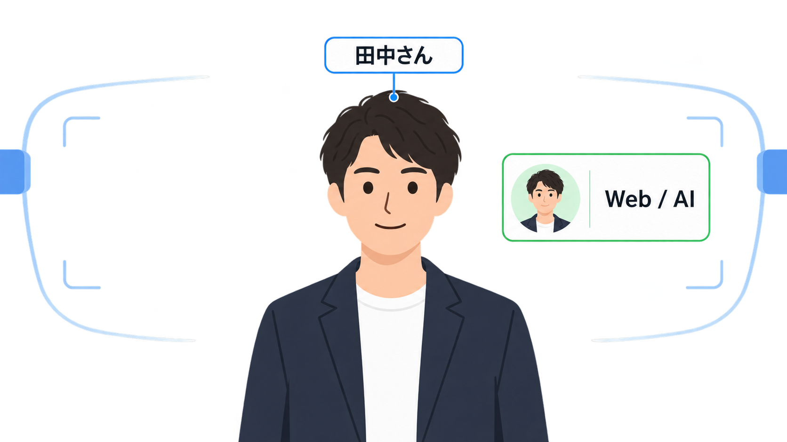
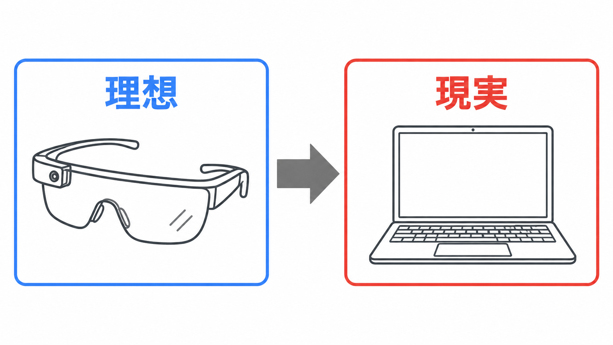
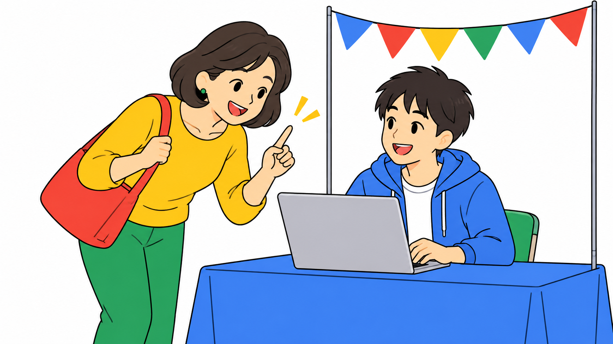

<script>
/* PowerPoint-style auto-shrink: iteratively reduce a slide's font size
   until its content stops overflowing. Also keeps the explicit opt-in
   <div class="fit">…</div> wrapper for finer-grained scaling. */
(() => {
  const MIN_FONT_PX = 12;
  const CODE_MIN_FONT_PX = 9;
  const STEP = 0.96;
  const MAX_ITERS = 40;
  const TOLERANCE = 1;
  let scheduled = false;

  const overflows = (el) =>
    el.scrollHeight > el.clientHeight + TOLERANCE ||
    el.scrollWidth  > el.clientWidth  + TOLERANCE;

  const shrinkElement = (el, minFontPx, shouldShrink = () => overflows(el)) => {
    if (!shouldShrink()) return;
    const base = parseFloat(getComputedStyle(el).fontSize) || 18;
    let size = base;
    for (let i = 0; i < MAX_ITERS && shouldShrink() && size > minFontPx; i++) {
      size *= STEP;
      el.style.fontSize = `${size}px`;
    }
  };

  const shrinkCodeBlocks = (section) => {
    for (const pre of section.querySelectorAll("pre")) {
      shrinkElement(pre, CODE_MIN_FONT_PX, () => overflows(pre) || overflows(section));
    }
  };

  const shrinkSection = (section) => {
    if (section.dataset.autofit === "skip") return;
    shrinkElement(section, MIN_FONT_PX, () => overflows(section));
  };

  const scaleFitBlocks = (root) => {
    for (const fit of root.querySelectorAll(".fit")) {
      if (!fit.scrollHeight) continue;
      const ratio = Math.min(1, fit.clientHeight / fit.scrollHeight);
      fit.style.transformOrigin = "top left";
      fit.style.transform = `scale(${ratio})`;
    }
  };

  const processSection = (section) => {
    if (!section.clientWidth || !section.clientHeight) return;
    scaleFitBlocks(section);
    shrinkCodeBlocks(section);
    shrinkSection(section);
  };

  const processVisibleSections = () => {
    scheduled = false;
    for (const section of document.querySelectorAll("section")) processSection(section);
  };

  const schedule = () => {
    if (scheduled) return;
    scheduled = true;
    requestAnimationFrame(() => requestAnimationFrame(processVisibleSections));
  };

  window.addEventListener("load", schedule);
  window.addEventListener("resize", schedule);
  new MutationObserver(schedule).observe(document.documentElement, {
    subtree: true,
    attributes: true,
    attributeFilter: ["class"],
  });
  schedule();
})();
</script>

<style>
:root {
  --gdg-university: 'GDG Greater Kwansai';
}

/* GDGのロゴとブランド行は全スライドから外す */
section::before,
section.title::before {
  content: '' !important;
  background-image: none !important;
  padding-left: 0 !important;
  width: 0 !important;
  height: 0 !important;
}

section.title::after { content: '' !important; }

/* 通常スライドは中央寄せ。右側の装飾と余白を外して画面中央を使い切る */
section:not(.title):not(.lead):not(.section):not(.invert):not(.split) {
  background-image: none !important;
  padding-right: 80px !important;
  justify-content: center;
  align-items: center;
  text-align: center;
  font-size: 30px;
}

section:not(.title):not(.lead):not(.section):not(.invert):not(.split) h1,
section:not(.title):not(.lead):not(.section):not(.invert):not(.split) h2 {
  display: block;
  margin-left: auto;
  margin-right: auto;
  line-height: 1.18;
}

section:not(.title):not(.lead):not(.section):not(.invert):not(.split) h2 {
  font-size: 1.6em;
  margin-bottom: 22px;
}

/* 箇条書きは中央のかたまりとして置き、行頭は左揃えのまま */
section:not(.title):not(.lead):not(.section):not(.invert):not(.split) ul,
section:not(.title):not(.lead):not(.section):not(.invert):not(.split) ol {
  display: inline-block;
  max-width: 1000px;
  text-align: left;
}

/* ![bg right] で本文カラムが狭くなる場合は左揃え・小さめにして折り返しを防ぐ */
section[data-marpit-advanced-background="content"]:not(.title):not(.lead):not(.section):not(.invert):not(.split) {
  text-align: left;
  align-items: flex-start;
  font-size: 25px;
}

section[data-marpit-advanced-background="content"]:not(.title):not(.lead):not(.section):not(.invert):not(.split) h2 {
  margin-left: 0;
  font-size: 1.5em;
  text-align: left;
}

section[data-marpit-advanced-background="content"]:not(.title):not(.lead):not(.section):not(.invert):not(.split) ul {
  display: block;
  max-width: none;
}

section.title h1 {
  font-size: 62px;
  max-width: 94%;
  line-height: 1.12;
}

section.title h2 { font-size: 28px; }

section.lead h1 {
  font-size: 2.5em;
  line-height: 1.2;
}

section.lead blockquote { font-size: 56px; }

section.invert { text-align: center; justify-content: center; }
section.invert pre { text-align: left; max-width: 820px; margin: 0 auto; }
section.invert .note { color: #BDC1C6; }

.big.sm { font-size: 1.62em; }

.big {
  font-size: 1.95em;
  font-weight: 700;
  line-height: 1.25;
  margin: 10px auto 0;
}

.support {
  font-size: 1.25em;
  font-weight: 600;
  line-height: 1.45;
  margin-top: 26px;
}

.note {
  color: var(--gdg-muted);
  font-size: 0.85em;
  line-height: 1.4;
  margin-top: 24px;
}

.profile {
  display: grid;
  grid-template-columns: 280px minmax(360px, 1fr);
  gap: 48px;
  align-items: center;
  justify-content: center;
  max-width: 880px;
  margin: 24px auto 0;
  text-align: left;
}

.profile img {
  width: 280px;
  height: 280px;
  object-fit: cover;
  border-radius: 50%;
  box-shadow: 0 16px 38px rgba(32, 33, 36, 0.18);
}

.profile ul {
  font-size: 1.05em !important;
  line-height: 1.55 !important;
  margin: 0 !important;
}

.shot {
  display: block;
  max-width: 760px;
  width: 100%;
  margin: 8px auto 0;
}

.flow {
  display: flex;
  align-items: stretch;
  justify-content: center;
  gap: 10px;
  margin: 30px auto 0;
  max-width: 1040px;
}

.flow .node {
  display: flex;
  align-items: center;
  justify-content: center;
  min-width: 150px;
  min-height: 92px;
  padding: 16px 18px;
  border: 3px solid var(--gdg-blue);
  border-radius: 8px;
  background: #fff;
  font-size: 0.8em;
  font-weight: 700;
  line-height: 1.25;
}

.flow .node.yellow { border-color: var(--gdg-yellow); }
.flow .node.green  { border-color: var(--gdg-green); }
.flow .node.red    { border-color: var(--gdg-red); }

.arrow {
  display: flex;
  align-items: center;
  color: var(--gdg-muted);
  font-size: 26px;
  font-weight: 800;
}

/* おばちゃんの発言をそのまま並べるブロック */
.says {
  max-width: 980px;
  margin: 26px auto 0;
  text-align: left;
}

.says p {
  margin: 0 0 16px;
  padding: 18px 24px;
  border-left: 8px solid var(--gdg-yellow);
  border-radius: 0 10px 10px 0;
  background: #fff;
  font-size: 0.95em;
  font-weight: 600;
  line-height: 1.4;
}

.says p:last-child { margin-bottom: 0; }
.says p.punch { border-left-color: var(--gdg-red); }

/* 記憶が薄れていく様子 */
.fade {
  display: flex;
  justify-content: center;
  align-items: center;
  gap: 14px;
  margin: 30px auto 0;
}

.fade .step {
  padding: 20px 26px;
  border-radius: 10px;
  background: #fff;
  border-bottom: 6px solid var(--gdg-blue);
  font-size: 0.82em;
  font-weight: 700;
}

.fade .step.dim    { opacity: 0.55; border-bottom-color: var(--gdg-muted); }
.fade .step.dimmer { opacity: 0.25; border-bottom-color: var(--gdg-muted); }

.two-col {
  display: grid;
  grid-template-columns: repeat(2, minmax(0, 1fr));
  gap: 28px;
  max-width: 1000px;
  margin: 26px auto 0;
  text-align: left;
}

.panel {
  border-radius: 8px;
  border-top: 6px solid var(--gdg-blue);
  background: #fff;
  padding: 24px;
}

.panel h3 { margin: 0 0 14px; font-size: 1.0em; }
.panel ul { font-size: 0.76em !important; line-height: 1.5 !important; margin: 0 0 0 1.1em !important; }
.panel.ok { border-top-color: var(--gdg-green); }
.panel.ng { border-top-color: var(--gdg-red); }

.compare {
  width: 94%;
  margin: 22px auto 0;
  border-collapse: collapse;
  font-size: 0.8em;
  text-align: left;
}

.compare th,
.compare td {
  border-bottom: 2px solid rgba(32, 33, 36, 0.12);
  padding: 15px 18px;
  vertical-align: top;
}

.compare th {
  background: transparent;
  color: var(--gdg-blue);
  font-size: 1.0em;
  font-weight: 700;
}
.compare td:first-child { font-weight: 700; color: var(--gdg-ink); }
</style>

<!-- _class: title -->
<!-- _paginate: false -->

# ドッグフーディングの**結果**<br>~デジタル学園祭を添えて~

## 知らないおばちゃんがめっちゃアドバイスくれた話

tanahiro2010 / 2026.10.10

---

<!-- _class: lead -->

# 今日は知らないおばちゃんに<br>**設計を壊された**話をします

---

<!-- _class: section -->

# 01. 僕が作っているもの

---

## E.D.I.T.H（自称）

<div class="big">
ARグラスをかけると<br>相手の顔の上に名前が出てくるやつ
</div>

<div class="note">
名前は某映画のアレから拝借しました
</div>

---

## 見える景色はこんな感じ



<div class="note">
カメラが顔を認識して、ネームタグとプロフィールを重ねて表示します
</div>

---

## スマートグラスが届きません



<div class="support">
ARどこいった
</div>

<div class="note">
発送通知はいまだに来ていません
</div>

---

<!-- _class: section yellow -->

# 02. デジタル学園祭にて

---

## 当初の作戦

- デジタル学園祭の来場者に片っ端から試してもらう
- 来場者はほぼ大学生か社会人、でも技術の話なら仲良くなれるはず
- 我ながら完璧な作戦でした

<div class="note">
このあと、完璧ではないことが判明します
</div>

---



## 知らないおばちゃんが<br>現れました

- 周りは大学生と社会人ばかりなのに、明らかに別枠です
- なぜか僕のブースにだけ興味津々です
- そして怒涛のアドバイスが始まりました

---

## もらったアドバイス

<div class="says">
<p>名前が見えるだけじゃ弱くない？</p>
<p>その人のプロフィールとか、どんな人か分かるようにした方がいいんじゃない？</p>
<p class="punch">てかそもそもパソコンじゃ意味ないぜよ</p>
</div>

---


<!-- _class: lead -->

> そのソフト、もっと**UX**を<br>考えた方がいいんじゃない？
>
> — 知らないおばちゃん

---

## 返す言葉がありませんでした

- 名前さえ見えれば完成だと思っていました
- でも**体験**のことは、一度も考えたことがなかったです
- 知らないおばちゃんに急所を突かれました

---

<!-- _class: section green -->

# 03. UXを考えてみた

---

## 名前だけ分かれば解決するのか

- 「あれ、この人誰だっけ？」
- 「前に話した気がするけど、何話したっけ？」
- 「名前は分かるけど、どういう人だったっけ？」

<div class="support">
名前を思い出せても、会話は始まりません
</div>

---

## つまりこういうことです

<div class="big">
名前を覚えることと<br>人を覚えることは<strong>違う</strong>
</div>

---

## 昨日話した内容、全部言えますか

<div class="fade">
<div class="step">さっきの会話</div>
<div class="step dim">昨日の会話</div>
<div class="step dimmer">先週の会話</div>
</div>

<div class="support">
そもそも人は、会話しながらメモを取りません
</div>

---

## 議事録機能を作り始めました

<div class="flow">
<div class="node">会話を録音</div><span class="arrow">→</span>
<div class="node yellow">文字起こし</div><span class="arrow">→</span>
<div class="node green">話題ごとに分類</div><span class="arrow">→</span>
<div class="node red">Markdownで保存</div>
</div>

<div class="note">
録音と記録は、相手の同意を得た場合だけ行います
</div>

---

<!-- _class: invert -->

## こんな形で残ります

```markdown
## 2026-10-10 デジタル学園祭 / おばちゃん

### もらったアドバイス

- 名前だけでは弱い
- プロフィールも出した方がいい

### 次にやること

- UXを考え直す
```

<div class="note">
分類精度はお察しください（絶賛改善中です）
</div>

---

## まだ足りませんでした

- 久しぶりに会った人の名前を思い出したい
- そもそも、その人を登録したかどうかを覚えていません
- 登録した人を一覧で見られないのは不便です

<div class="support">
あれ、これもUXの問題では？
</div>

---

## 名前一覧機能も作り始めました

<div class="two-col">
<div class="panel ok">
<h3>やりたいこと</h3>
<ul>
<li>登録した人を一覧で見返せる</li>
<li>プロフィールと過去の会話もまとめて確認できる</li>
<li>会う前に相手を思い出せる</li>
</ul>
</div>
<div class="panel ng">
<h3>いま困っていること</h3>
<ul>
<li>アカウント機能がまだありません</li>
<li>他の利用者の登録情報まで見えてしまいます</li>
<li>さすがにこのままでは公開できません</li>
</ul>
</div>
</div>

<div class="note">
認証とアクセス制御を実装中です
</div>

---

<!-- _class: section red -->

# 04. 気づいたこと

---

## 作りながら分かったこと

<div class="big sm">
「情報を表示すること」と<br>「コミュニケーションを助けること」は<strong>違う</strong>
</div>

<div class="note">
名前が分かっても相手を知らなければ会話は続かないし、<br>話した内容が残っていても必要なときに出てこなければ意味がありません
</div>

---

## E.D.I.T.Hが目指すもの

<table class="compare">
<thead>
<tr><th></th><th>当初</th><th>いま</th></tr>
</thead>
<tbody>
<tr><td>見せるもの</td><td>名前</td><td>名前・プロフィール・過去の会話</td></tr>
<tr><td>解きたい課題</td><td>顔と名前が一致しない</td><td>相手のことを思い出せない</td></tr>
<tr><td>ゴール</td><td>表示したら終わり</td><td>次の会話につながる</td></tr>
</tbody>
</table>

<div class="support">
人を覚えるツールから、人とのつながりを支えるツールへ
</div>

---

## 課題はまだ山積みです

- スマートグラスが届きません
- 議事録の分類精度が低いです
- アカウント機能がありません
- 個人情報の管理方針が決まっていません
- そもそも本当に使いやすいのか、まだ分かりません

<div class="support">
というか、まだスマートグラスで動いてすらいません
</div>

---

## 今回の学び

- 自分が便利だと思う機能と、ユーザーが必要とする機能は違いました
- 開発者はどうしても「何を実装するか」から考えてしまいます
- 本当に大事なのは「ユーザーがどう使うか」でした

---

<!-- _class: lead -->

# UXは画面の中だけの話じゃない

使う前と後まで含めた、体験そのものでした

---

## 最後に

- 正直、名前が表示されれば完成だと思っていました
- 他人の視点を入れた途端、自分では気づけなかった課題が次々出てきました
- **自分の作ったものを、自分だけで評価してはいけない**

---

<!-- _class: lead -->

# ありがとう<br>**名も知らぬおばちゃん**

---

<!-- _class: lead -->

# Thank you!

おばちゃんの目撃情報、お待ちしています
